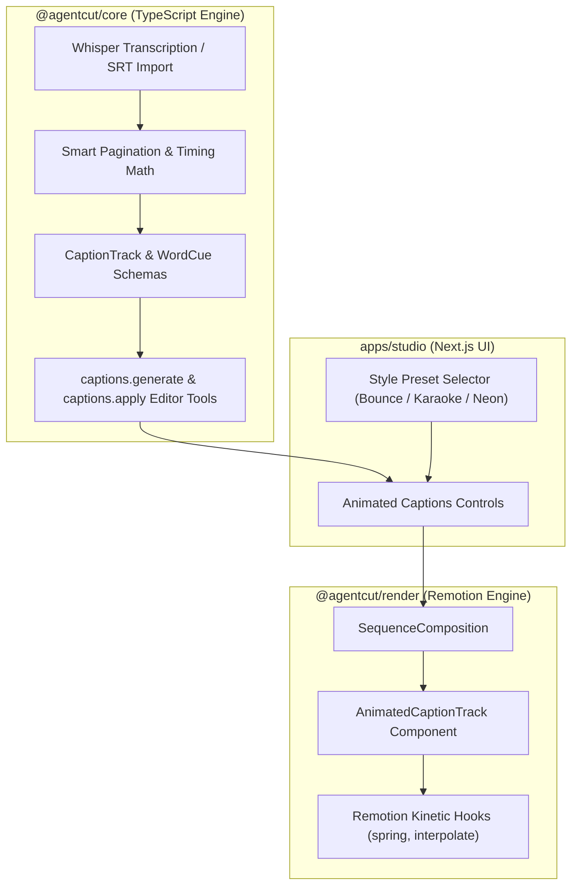

# AgentCut High-Retention Animated Captions Design

Date: 2026-11-04

## Intent

Empower creators to produce viral short-form videos directly inside AgentCut with word-level animated typography, smart pagination, and kinetic styles (Bounce, Karaoke Pill, Neon Glow, Typewriter) rendered natively via Remotion.

## Background & Problem

Short-form platforms (TikTok, Instagram Reels, YouTube Shorts) heavily depend on dynamic, synchronized on-screen captions to maintain viewer retention. While AgentCut currently transcribes audio via Whisper and can draft basic text overlays, it lacks:
1. **Word-Level Kinetic Animations:** Synchronized word pops, active speaker highlights, and glowing pills.
2. **Smart Pagination Math:** Natural phrase splitting that respects human speech pauses rather than awkwardly breaking words mid-sentence.
3. **Preset Short-Form Styles:** Viral kinetic typography presets ready out-of-the-box.

By integrating the architectural patterns from `Fats403/remotion-captions-kit` and `ahgsql/remotion-subtitles` natively into `@agentcut/core` and `@agentcut/render`, we provide an end-to-end animated caption system with zero external runtime overhead.

## Architecture

## Key Modules & Responsibilities

1. **`@agentcut/core/src/modules/captions`**:
   - `types.ts`: Zod schemas for `WordTiming`, `CaptionPage`, `CaptionTrack`, and `CaptionStylePreset`.
   - `lib/pagination.ts`: Splits raw Whisper word timestamps into natural reading pages (max characters per line, speaker pause thresholds).
   - `lib/srt-parser.ts`: Robust subtitle parser handling decimal commas/dots and converting SRT to timed word tokens.
   - `server/tools.ts`: Shared editor tools (`captions.generate`, `captions.apply`, `captions.presets`).

2. **`@agentcut/render/src/captions`**:
   - `AnimatedCaptionTrack.tsx`: Frame-accurate Remotion component reading the active sequence time.
   - `styles/BounceCaption.tsx`: Spring-driven word scale pop on speech.
   - `styles/KaraokeCaption.tsx`: Background highlight pill with active color shifts.
   - `styles/NeonCaption.tsx`: Vibrant glow drop-shadow with kinetic letter spacing.
   - `styles/TypewriterCaption.tsx`: Progressive text reveal.

3. **`apps/studio/src/modules/captions`**:
   - `components/caption-style-picker.tsx`: Visual selector for caption presets with live preview.
   - Timeline track rendering for synchronized caption segments.
